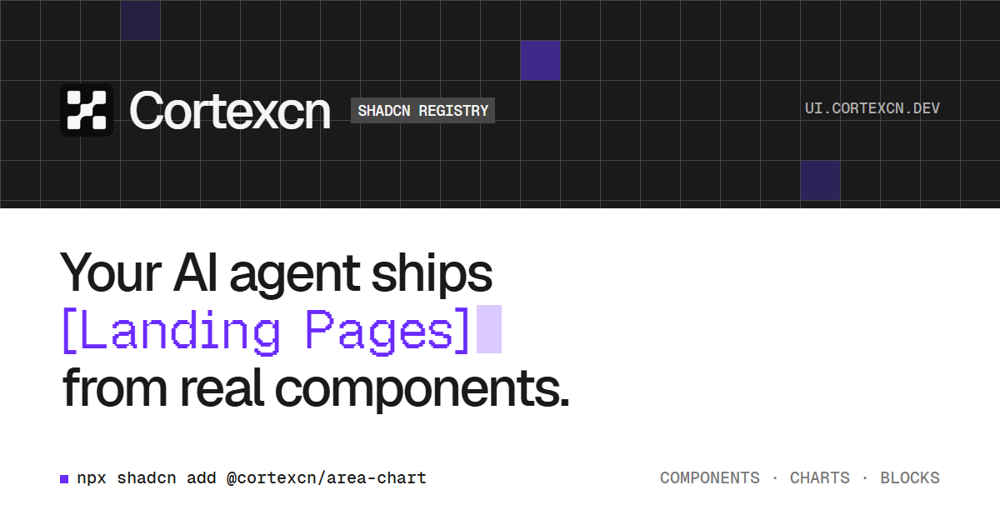

# Cortexcn

React and Tailwind CSS components, page blocks, and charts that you install with the shadcn CLI. The source is copied into your project, so you can read it, change it, and make it your own. Open source, and set up for your AI agent as well as for you.



## Documentation

Visit [ui.cortexcn.dev/docs](https://ui.cortexcn.dev/docs) to view the documentation.

## What's inside

- **Components.** The shadcn/ui primitives (accordion, dialog, select, tabs, and the rest) plus Cortexcn components such as Marquee, Number Ticker, Line Nav, Sphere Menu, Gooey Nav, and Lanyard 3D.
- **Cortexcn Blocks.** Page sections in six categories: hero, features, services, AI assistant, loaders, and stat cards. [Browse the blocks](https://ui.cortexcn.dev/blocks).
- **Charts.** Area, bar, candlestick, choropleth, composed, funnel, gauge, heatmap, line, live line, profit and loss line, pie, radar, ring, sankey, scatter, and sunburst charts, built on visx and Motion. [Browse the charts](https://ui.cortexcn.dev/charts).
- **Templates.** Complete Next.js sites to download and make your own: Portfolio (free, MIT), plus the paid Simplistic SaaS, AI Travel App, Growth Agency, Trek Agency, Legal AI, and Marketing Ops. [Browse the templates](https://ui.cortexcn.dev/templates).
- **AI tools.** An MCP server, agent skills, and a `DESIGN.md` file, so coding agents can find the right item, install it, and match the design system.

## Quick start

Set up shadcn/ui in your project:

```bash
npx shadcn@latest init
```

Add any item by its registry URL:

```bash
npx shadcn@latest add https://ui.cortexcn.dev/r/line-chart.json
```

Or register the `@cortexcn` namespace once in `components.json`:

```json
{
  "registries": {
    "@cortexcn": "https://ui.cortexcn.dev/r/{name}.json"
  }
}
```

and then add items by name:

```bash
npx shadcn@latest add @cortexcn/line-chart
```

The CLI writes the files into your project, installs the npm packages the item needs, and pulls in any other Cortexcn items it depends on. Charts land in your components folder, so you import them from there:

```tsx
import { LineChart } from "@/components/charts";
```

Each item's page in the [docs](https://ui.cortexcn.dev/docs) shows its install command, usage, and props.

## Use it with your AI agent

**MCP server.** Connect your assistant to `https://ui.cortexcn.dev/mcp` and it can search the catalog, read an item's docs and source, and get the exact install command. The server is read-only and needs no sign-in. In Claude Code:

```bash
claude mcp add --transport http cortexcn https://ui.cortexcn.dev/mcp
```

Setup for Cursor, VS Code, Codex, Windsurf, Zed, and the chat apps is in the [MCP docs](https://ui.cortexcn.dev/docs/integration/mcp). Each IP address can make 120 requests a minute and 3,000 a day.

**Agent kit.** Skills that teach your agent to find, install, compose, and theme Cortexcn items, plus a `DESIGN.md` for your project root that describes the design system (colors, corners, type, spacing, and motion):

```bash
npx shadcn@latest add https://ui.cortexcn.dev/r/agent-kit.json
```

To install only one part, use `agent-skills.json` or `design-md.json` in place of `agent-kit.json`. The skills CLI works too:

```bash
npx skills add https://ui.cortexcn.dev
```

## Development

You need Node.js 18 or later (CI uses Node 20) and [Bun](https://bun.sh) 1.4.0, the version pinned in `package.json`.

```bash
bun install
bun run dev
```

`bun run dev` starts one dev server on three ports, so each site can stay open in its own tab: the services site at <http://localhost:4410>, the component library home at <http://localhost:4420>, and the components docs at <http://localhost:4430>. Change the numbers in `apps/web/dev-ports.json`. In production one deployment serves both: the library (its home, docs, blocks, charts, templates, registry, and MCP server) on `ui.cortexcn.dev`, and the services site on `www.cortexcn.dev`.

The site runs without any environment variables. Features that need a key, such as the contact form and analytics, stay off locally.

Scripts, all run from the repository root:

| Command                   | What it does                                                                   |
| ------------------------- | ------------------------------------------------------------------------------ |
| `bun run dev`             | Runs the dev servers through Turborepo                                         |
| `bun run build`           | Builds every package through Turborepo                                         |
| `bun run lint`            | Checks formatting and lint rules with Ultracite (Biome)                        |
| `bun run lint:fix`        | Applies Ultracite fixes (`bun run format` does the same)                       |
| `bun run check-types`     | Type checks every package                                                      |
| `bun run test`            | Runs the unit tests (Node's test runner with `tsx`)                            |
| `bun run registry:build`  | Rebuilds the registry into `apps/web/public/r`                                 |
| `bun run registry:verify` | Checks that registry files, npm dependencies, and the built output are in sync |

Keep the `run`: `bun build` and `bun test` start Bun's own bundler and test runner instead of these scripts.

A pre-commit hook runs Biome on your staged files. Text files check out with LF line endings on every OS, which is what Biome expects.

## Repository layout

| Path                         | Contents                                                                                                                                                     |
| ---------------------------- | ------------------------------------------------------------------------------------------------------------------------------------------------------------ |
| `apps/web`                   | The Next.js site: docs (MDX in `content/docs`), block sources (`blocks`), chart gallery, the MCP route (`app/mcp`), and the built registry JSON (`public/r`) |
| `packages/ui`                | `@cortexcn/ui`: component and chart source, `registry.json`, and the scripts that build and verify the registry                                              |
| `packages/icons`             | `@cortexcn/icons`: a wrapper around Central Icons (`@central-icons-react/all`), a licensed icon set                                                          |
| `packages/eslint-config`     | `@cortexcn/eslint-config`: shared ESLint config                                                                                                              |
| `packages/typescript-config` | `@cortexcn/typescript-config`: shared TypeScript configs                                                                                                     |
| `templates/`                 | Standalone Next.js site templates. They are not part of the Bun workspace, and each has its own README and LICENSE                                           |

## Contributing

Please read the [contributing guide](./CONTRIBUTING.md). It covers setup, where things live, and what a good pull request looks like. Step-by-step recipes for adding a component, block, or chart are in [AGENTS.md](./AGENTS.md).

- Code of conduct: [CODE_OF_CONDUCT.md](./CODE_OF_CONDUCT.md)
- Security issues: please report them privately, as described in [SECURITY.md](./SECURITY.md)

## License

Licensed under the [MIT license](./LICENSE). Templates in `templates/` carry their own license files, and the paid templates are not in this repository.
